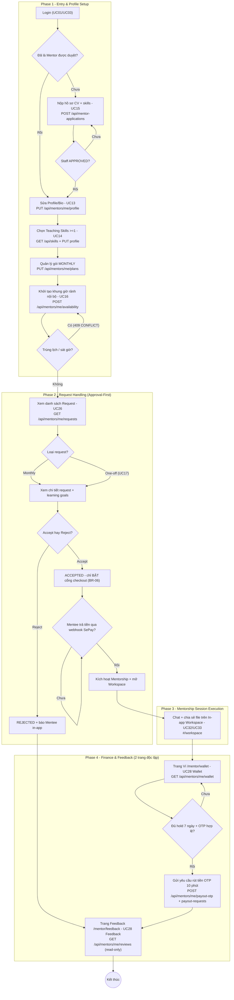

# Business Flow — Role Mentor (branch `Trung`)

- Ngày lập: 2026-10-27 | Branch: `Trung`
- Nguồn đối chiếu: code thật tại commit hiện tại (`backend/src/**`, `frontend/src/roles/mentor/**`, `frontend/src/main.js`) và numbering của `SRS_G3_Final_Updated.docx` (UC14 = Teaching Skills, UC16 = Select Time Slot, UC17 = One-Off approval-first, UC28 tách Wallet/Feedback, UC33 = In-app Session).
- Mọi node dưới đây đều có mỏ neo code đã kiểm chứng bằng grep; không node nào là suy đoán.

---

## 1. Mermaid Flowchart (dán vào Draw.io: Insert → Advanced → Mermaid)

---

## 2. Bảng Node (kéo thả thủ công trên Draw.io)

### 2.1 Node hành động — hình chữ nhật

| ID | Nhãn | Mỏ neo code |
|---|---|---|
| A1 | Login (UC01/UC03) | luồng auth chung |
| A2 | Nộp hồ sơ CV + skills (UC15) | [MentorApplicationController.java:39](file:///D:/swp/Happy-Programming-Mentorship-System/backend/src/main/java/com/happyprogramming/controller/MentorApplicationController.java#L39) POST `/api/mentor-applications`; OTP verify `:52`; Staff quyết định `:66` |
| A3 | Sửa Profile/Bio (UC13) | [MentorController.java:78](file:///D:/swp/Happy-Programming-Mentorship-System/backend/src/main/java/com/happyprogramming/controller/MentorController.java#L78) PUT `/api/mentors/me/profile` |
| A4 | Chọn Teaching Skills ≥1 (UC14) | [MentorController.java:85](file:///D:/swp/Happy-Programming-Mentorship-System/backend/src/main/java/com/happyprogramming/controller/MentorController.java#L85) GET `/api/skills`; `skillIds @Size(min=1)` trong `MentorProfileRequest` |
| A5 | Quản lý gói MONTHLY | [MentorPlanController.java:36](file:///D:/swp/Happy-Programming-Mentorship-System/backend/src/main/java/com/happyprogramming/controller/MentorPlanController.java#L36) PUT `/api/mentors/me/plans` |
| A6 | Khởi tạo khung giờ rảnh nội bộ (UC16) | [MentorAvailabilityController.java:47](file:///D:/swp/Happy-Programming-Mentorship-System/backend/src/main/java/com/happyprogramming/controller/MentorAvailabilityController.java#L47) POST; xóa slot `:54`; UI `#/mentor/availability` |
| B1 | Xem danh sách Request (UC26) | [MentorController.java:100](file:///D:/swp/Happy-Programming-Mentorship-System/backend/src/main/java/com/happyprogramming/controller/MentorController.java#L100) GET `/api/mentors/me/requests`; dashboard `:95` |
| B2 | Xem chi tiết request + learning goals | cùng endpoint B1 (payload chi tiết) |
| B3 | REJECTED + báo Mentee in-app | [MentorDashboardService.java:144](file:///D:/swp/Happy-Programming-Mentorship-System/backend/src/main/java/com/happyprogramming/service/MentorDashboardService.java#L144) notification `MENTORSHIP_REQUEST_REJECTED` |
| B4 | ACCEPTED — chỉ BẬT checkout (BR-06) | [MentorshipRequestService.java:382,403](file:///D:/swp/Happy-Programming-Mentorship-System/backend/src/main/java/com/happyprogramming/service/MentorshipRequestService.java#L382) guard `funded_at IS NULL` + status |
| B5 | Kích hoạt Mentorship + mở Workspace | settlement webhook SePay → subscription + workspace |
| C1 | Chat + chia sẻ file In-app Workspace (UC32/UC33) | [MentorshipWorkspaceController.java:48,56](file:///D:/swp/Happy-Programming-Mentorship-System/backend/src/main/java/com/happyprogramming/controller/MentorshipWorkspaceController.java#L48) POST messages/files; route `#/workspace` ([main.js:492](file:///D:/swp/Happy-Programming-Mentorship-System/frontend/src/main.js#L492)) |
| E1 | Trang Ví `/mentor/wallet` (UC28 Wallet) | [MentorWalletController.java:24](file:///D:/swp/Happy-Programming-Mentorship-System/backend/src/main/java/com/happyprogramming/controller/MentorWalletController.java#L24) GET wallet; route [main.js:561](file:///D:/swp/Happy-Programming-Mentorship-System/frontend/src/main.js#L561) |
| E2 | Rút tiền OTP 10 phút | [MentorWalletController.java:36,42](file:///D:/swp/Happy-Programming-Mentorship-System/backend/src/main/java/com/happyprogramming/controller/MentorWalletController.java#L36); expiry [MentorWalletService.java:44](file:///D:/swp/Happy-Programming-Mentorship-System/backend/src/main/java/com/happyprogramming/service/MentorWalletService.java#L44) |
| E3 | Trang Feedback `/mentor/feedback` (UC28 Feedback, read-only) | [MentorReviewController.java:23](file:///D:/swp/Happy-Programming-Mentorship-System/backend/src/main/java/com/happyprogramming/controller/MentorReviewController.java#L23) GET reviews; chỉ `PUBLISHED` ([MentorReviewRepository.java:30](file:///D:/swp/Happy-Programming-Mentorship-System/backend/src/main/java/com/happyprogramming/repository/MentorReviewRepository.java#L30)); route [main.js:565](file:///D:/swp/Happy-Programming-Mentorship-System/frontend/src/main.js#L565) |

### 2.2 Node rẽ nhánh — hình thoi

| ID | Câu hỏi | Căn cứ code |
|---|---|---|
| D1 | Đã là Mentor được duyệt? | role check sau login |
| D2 | Staff APPROVED? | `MentorApplicationController:66` decision |
| D3 | Trùng lịch / sát giờ? | conflict engine trả 409 ([SlotHoldService.java:64](file:///D:/swp/Happy-Programming-Mentorship-System/backend/src/main/java/com/happyprogramming/service/SlotHoldService.java#L64)); `MIN_ADVANCE_HOURS=2` `:29,74` |
| D4 | Loại request: Monthly / One-off? | `service_type` badge (UC17 đi chung luồng duyệt) |
| D5 | Accept hay Reject? | [MentorController.java:105](file:///D:/swp/Happy-Programming-Mentorship-System/backend/src/main/java/com/happyprogramming/controller/MentorController.java#L105) PUT `.../decision`; `MentorDashboardService:90` |
| D6 | Mentee trả tiền qua webhook SePay? | chỉ webhook settle; `funded_at` set khi SUCCEEDED |
| D7 | Đủ hold 7 ngày + OTP hợp lệ? | release [MentorWalletService.java:297](file:///D:/swp/Happy-Programming-Mentorship-System/backend/src/main/java/com/happyprogramming/service/MentorWalletService.java#L297) `paid_at <= now-7d`; OTP verify `:169,191` |

### 2.3 Nhãn mũi tên điều kiện (edge labels)

| From → To | Nhãn |
|---|---|
| D1 → A2 | Chưa |
| D2 → A2 | Chưa (PENDING/REJECTED) |
| D1/D2 → A3 | Rồi / APPROVED |
| D3 → A6 | Có (409 CONFLICT) |
| D3 → B1 | Không |
| D4 → B2 | Monthly / One-off (UC17) |
| D5 → B3 | Reject |
| D5 → B4 | Accept |
| D6 → D6 | Chưa |
| D6 → B5 | Rồi |
| B5 → C1 | (kích hoạt) |
| D7 → E1 | Chưa |
| D7 → E2 | Rồi |
| E2 → E3 | (hoàn tất rút tiền) |
| B3 → E3 | (kết thúc nhánh reject) |

---

## 3. Ghi chú khi vẽ

- Phase 4 là **2 trang độc lập** (`/mentor/wallet` và `/mentor/feedback`), KHÔNG gộp — khớp UC28 đã tách trong SRS updated và nav 2 mục tại [MentorLayout.js:13-14](file:///D:/swp/Happy-Programming-Mentorship-System/frontend/src/roles/mentor/MentorLayout.js#L13).
- Nhánh One-off (UC17) đi **chung** luồng duyệt approval-first với Monthly; khác biệt duy nhất là badge `service_type` và copy accept (không nhắc thanh toán).
- Hold slot 10 phút (BR-10) và đặt trước ≥2 giờ (BR-11) nằm ở Phase 1/2 biên mentor–mentee; job nhả hold quá hạn là `SlotHoldExpiryJob`.
