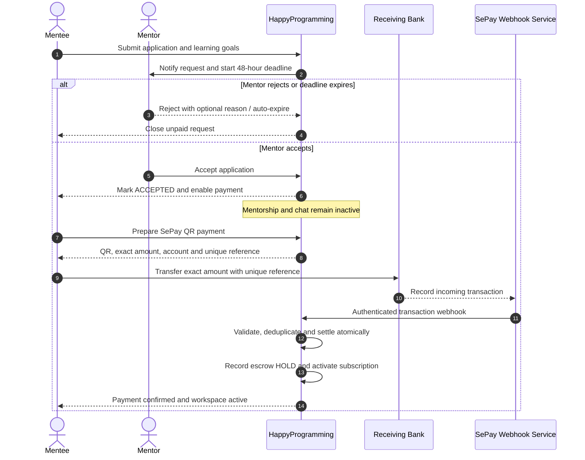

# System Specification: HappyProgramming Mentorship Management System (HPMS)

> **Document Type:** GitHub Spec Kit Product Specification (`spec.md`)
> **Source Material:** [`SRS_G3_V1.1 (2).docx`](../SRS_G3_V1.1%20%282%29.docx)
> **Active Payment Specification:** [`020-sepay-mentorship-checkout`](020-sepay-mentorship-checkout/spec.md)
> **Wallet and Payout Specification:** [`019-mentor-wallet-payout`](019-mentor-wallet-payout/spec.md)
> **Standard:** [GitHub Spec Kit](https://github.com/github/spec-kit) / [`AGENTS.md`](../AGENTS.md)
> **Version:** 1.1.0 (SePay-aligned baseline)
> **Status:** Approved / Active

---

## 1. Executive Summary and Vision

**HappyProgramming** is a web-based mentorship platform connecting aspiring developers (Mentees) with vetted software engineers (Mentors). It supports monthly mentorship, one-off sessions, learning roadmaps, code and portfolio review, private communication workspaces, verified reviews, and administration.

Paid mentorship uses a SePay-generated bank-transfer QR. Funds are received in the configured HappyProgramming bank account. SePay sends authenticated incoming-transaction webhook notifications; HappyProgramming verifies and reconciles those notifications before activating mentorship. The platform records verified funds in an internal append-only escrow ledger, holds the mentor share for seven days, releases eligible earnings to the mentor wallet, and lets administrators process payout requests by external bank transfer.

The internal escrow ledger is an application accounting mechanism. It must not be described as bank-regulated escrow or as funds held by SePay.

---

## 2. User Roles and External Systems

| Role | Type | Primary Responsibilities and Permissions |
| :--- | :--- | :--- |
| **Guest** | Unauthenticated | Explores public mentor profiles and skills; views verified reviews; registers as a Mentee or submits a Mentor application. |
| **Mentee** | Authenticated Client | Searches mentors; applies for monthly mentorship; books eligible sessions; pays using SePay bank-transfer QR; collaborates after payment verification; rates completed mentorships. |
| **Mentor** | Authenticated Provider | Manages profile, CV, packages, teaching skills, availability, and unified bookings; accepts or rejects monthly applications within 48 hours; conducts mentorship; views held and available wallet balances; requests payouts. |
| **Staff** | Operational Internal | Reviews mentor applications and CVs; manages mentees, mentorship requests, and global skills within assigned permissions. |
| **Admin** | System Administrator | Manages accounts and Staff permissions; reviews configuration, audit logs, revenue, reconciliation cases, and mentor payout requests; records completed external payouts. |

### External Systems and Integrations

- **SePay Bank Transaction Webhook (API-01):** Supplies QR-compatible bank-transfer instructions and sends incoming-transaction notifications to `POST /api/payments/sepay/webhook`. SePay does not hold HappyProgramming escrow funds.
- **Receiving Bank:** Receives the actual transfer into the configured HappyProgramming bank account.
- **Google OAuth2 (API-02):** Supports third-party authentication.
- **Email Service / Gmail SMTP (API-03):** Sends account verification, password-reset, application-decision, payment, payout, and session notifications.

Session availability and booking schedules are managed entirely inside HappyProgramming. The product does not integrate with Google Calendar or Google Meet; mentors may share an external call link through the private workspace when needed.

`specs/016-vnpay-mentorship-checkout/` and `docs/payments/vnpay-setup.md` are historical. They are not authoritative for current implementation or configuration.

---

## 3. Core Business Workflows

### 3.1 Approval-First Monthly Mentorship and SePay Settlement

### 3.2 Instant One-Off Session Booking

1. A Mentor publishes one-off session types and available time windows.
2. A Mentee selects a session type, a generated start time, the session quantity, and participant quantity.
3. HappyProgramming validates the active offering and atomically holds the complete consecutive time range. Mentor acceptance is not required.
4. The system creates an immediately payable order using an immutable total of `unit price × sessions × participants` and opens SePay checkout.
5. Only a verified exact SePay webhook converts the hold and creates confirmed one-off bookings. Browser actions cannot confirm payment or reserve a slot permanently.
6. An expired or conflicting hold cannot settle into a booking; the Mentee must select an available time again.

### 3.3 Escrow, Mentor Wallet, and Payout

1. A verified SePay payment creates one immutable gross `HOLD` entry.
2. The mentor share remains held for seven days from verified `paid_at`.
3. The release job appends the mentor share and platform-fee entries once.
4. Released and unreserved mentor earnings become available for withdrawal.
5. A payout request reserves the requested available balance.
6. An Admin performs the external bank transfer and records its reference before marking the request `PAID`, or rejects it with a reason and releases the reservation.
7. Financial corrections use append-only compensating entries; historical entries are never rewritten.

### 3.4 Mentor Onboarding and Approval

1. A Guest submits personal information, technical skills, experience, and permitted CV/certificate files.
2. Staff reviews the application and records an `APPROVED` or `REJECTED` decision.
3. Only approved, active mentors appear in public discovery.

### 3.5 Rating and Feedback

Mentees may submit a 1–5 star rating and comment only after an eligible mentorship or session is completed.

---

## 4. User Stories and Acceptance Scenarios

### US-01: Mentee Registration

- **As a** Guest, **I want to** register by email or Google OAuth2, **so that** I can apply for mentorship.
- A valid email registration creates a pending-verification account and sends a time-limited verification message.
- A duplicate email is rejected using the canonical validation response.

### US-02: Unified Sign-In and Role Routing

- **As a** registered user, **I want to** sign in without selecting a manual role tab, **so that** the system routes me to an authorized workspace.
- Locked, suspended, unverified, and inactive accounts cannot enter protected workspaces.

### US-03: Mentor Discovery

- **As a** Guest or Mentee, **I want to** search and filter approved mentors, **so that** I can find a suitable expert.
- Empty results display the canonical empty state and a clear-filter action.

### US-04: Mentor Profile and Verified Reviews

- **As a** Mentee, **I want to** inspect biography, skills, experience, packages, and verified reviews, **so that** I can evaluate fit before applying.

### US-05: Apply for Monthly Mentorship

- **As a** Mentee, **I want to** submit learning goals to a selected Mentor, **so that** the Mentor can decide whether to accept the engagement.
- A Mentee cannot have multiple concurrent pending applications with the same Mentor.
- A Mentor must accept or reject within 48 hours; an unanswered request expires without a refund because payment has not been enabled.
- Acceptance changes the request to `ACCEPTED` and enables payment. It does not activate the subscription, chat, escrow, or mentor earnings.

### US-05A: Unified Mentor Bookings

- **As a** Mentor, **I want to** manage monthly applications and one-off sessions from one Bookings page, **so that** I can see every mentoring commitment without switching between duplicate lists.
- Pending monthly applications retain Accept and Decline actions and show their 48-hour response deadline.
- One-off orders never require mentor approval. They show `Awaiting payment` before settlement and the persisted booking status and schedule after a verified SePay payment.
- Mentors can filter the combined list by lifecycle status and by Monthly or One-off type.
- Missing deadlines and schedules display `—`; the interface must not fabricate epoch dates.

### US-06: SePay QR Payment and Activation

- **As a** Mentee with an accepted request, **I want to** pay using a bank-transfer QR, **so that** the system can verify my transfer and activate mentorship.

**Scenario 1 — Prepare payment**

- **Given** the request is accepted and unpaid,
- **When** the Mentee starts checkout,
- **Then** the backend creates or reuses a `PENDING` payment attempt with the accepted price, unique transfer reference, commission snapshot, and 15-minute expiry,
- **And** checkout displays the backend-provided QR, receiving bank, account details, exact amount, reference, and countdown.

**Scenario 2 — Verified incoming transfer**

- **Given** a pending eligible payment attempt,
- **When** SePay delivers an authenticated incoming transaction matching the configured account, reference, and expected amount,
- **Then** the backend records the provider event once, marks payment `SUCCEEDED`, sets `funded_at`, appends the escrow `HOLD`, activates the subscription, and provisions the conversation in one transaction.

**Scenario 3 — Invalid, duplicate, or unmatched webhook**

- An unauthenticated request is rejected.
- A duplicate provider event returns an idempotent response and creates no duplicate financial or mentorship records.
- An outgoing, wrong-account, unknown-reference, insufficient, late, overpaid, or ambiguous transfer does not automatically activate mentorship and follows the active rejection or reconciliation policy.

**Scenario 4 — Expired attempt**

- An unpaid attempt expires after 15 minutes.
- The accepted mentorship request remains eligible for a new attempt with a new transfer reference.

### US-07: Mentorship Workspace

- **As a** paid Mentee or assigned Mentor, **I want to** use one private workspace per mentor–mentee relationship, **so that** monthly mentorship and one-off sessions can be coordinated without duplicate conversations.
- Workspace access requires an active subscription or confirmed eligible booking backed by a verified payment.
- Workspace access is limited to the assigned Mentor and Mentee and is provisioned only by verified SePay settlement of a monthly plan or one-off booking.
- The workspace is identified by the pair's approved conversation. It presents an optional active monthly context, independent paid one-off bookings, learning goals, and shared private conversation history.
- A monthly subscription changes from `TRIALING` to `ACTIVE` when its trial ends. If its paid period is not extended by a renewal, the system changes it to `ENDED` at `current_period_end`; no mentor action is required.
- When a confirmed one-off session reaches its scheduled end, the system completes it automatically, removes it from upcoming engagements, and retains it in collapsed session history for reviews, disputes, refunds, and audit.
- Mentorships first presents each active mentor/mentee pair once; purchasing another service from the same partner reuses that workspace.
- Members can exchange text messages and authorized learning-file attachments up to 10 MB.
- The header and mentorship list show unread-message badges; reading one workspace does not clear unread messages in another.
- Members may exchange text and code messages. Each message write uses a client key so retries do not create duplicates.
- The first release uses bounded HTTP polling for new messages; file uploads and meeting scheduling require separate approved specifications.

### US-08: Mentor Application and Credential Upload

- **As a** prospective Mentor, **I want to** submit profile and qualification evidence, **so that** Staff can verify my expertise.
- File type, size, ownership, and storage path are validated server-side.

### US-09: Mentor Wallet and Payout

- **As a** Mentor, **I want to** distinguish held, available, reserved, and paid-out balances, **so that** I understand and withdraw my earnings.
- Before seven days have elapsed, the mentor share is held and cannot be withdrawn.
- After the release job runs, the net mentor share becomes available exactly once.
- A payout cannot exceed available balance and reserves funds while awaiting Admin action.
- Marking a payout `PAID` requires a completed external transfer reference; rejection releases the reservation.

### US-10: Staff Mentor Moderation

- **As a** Staff member, **I want to** review Mentor applications, **so that** only qualified active Mentors are discoverable.

### US-11: Admin Governance and Revenue

- **As an** Admin, **I want to** inspect immutable audit logs, verified revenue, reconciliation cases, and payout requests, **so that** platform operations remain traceable.
- Revenue includes only server-verified successful payments and their corresponding ledger entries.

---

## 5. Global Business Rules

| ID | Business Rule Statement | Enforcement Layer |
| :--- | :--- | :--- |
| **GB-01** | Each email address belongs to at most one HappyProgramming account. | Database unique constraint and service validation. |
| **GB-02** | Passwords meet the configured security policy. | Client validation and backend Bean Validation. |
| **GB-03** | Verification and reset credentials expire after their configured lifetime. | Server-side timestamp validation. |
| **GB-04** | Only approved and active Mentor profiles are publicly visible. | Repository predicates and service authorization. |
| **GB-05** | Only active Staff-managed skills may be assigned or discovered. | Foreign keys and active-status filtering. |
| **GB-06** | A Mentee cannot hold multiple concurrent pending applications with the same Mentor. | Transactional service validation and database safeguards. |
| **GB-07** | Monthly mentorship payment is enabled only after Mentor acceptance. | Request-state transition guard. |
| **GB-08** | Mentorship activation requires a successfully verified SePay incoming-transaction webhook. | Webhook authentication, reconciliation, and atomic settlement. |
| **GB-09** | Reviews require a completed eligible mentorship or booking. | Ownership and booking-status checks. |
| **GB-10** | Only Admin may modify Staff authorization and decide payout requests. | Spring Security and service authorization. |
| **GB-11** | Administrative decisions and configuration changes are audit logged. | Transactional audit service. |
| **GB-12** | Audit and financial ledger records are append-only through application workflows. | Database and service restrictions. |
| **GB-13** | Revenue reports include only verified successful payments and matching ledger records. | Financial aggregation queries. |
| **GB-14** | Staff actions are limited by assigned permissions. | Fine-grained authorization. |
| **GB-15** | Request, payment, subscription, and payout states follow validated lifecycle transitions. | Service guards and database constraints/triggers. |
| **GB-16** | Mentor decisions are due 48 hours after submission using UTC timestamps. | Scheduler and persisted deadline. |
| **GB-17** | Verified funds are held in the internal escrow ledger; mentor earnings release after seven days and only available unreserved balance may be paid out. | Ledger service and idempotent release job. |
| **GB-18** | Pending payment attempts expire after 15 minutes; expiration cannot convert an unverified payment to success. | Expiry scheduler and payment-state guard. |

---

## 6. Background Jobs

| Job | Frequency | Behavior |
| :--- | :--- | :--- |
| `AuditLogCleanupJob` | Configured schedule | Applies the approved audit-retention policy without modifying protected financial history. |
| `PendingPaymentExpiryJob` | Configurable; current default scan is 60 seconds | Expires overdue `PENDING` payment attempts and releases eligible temporary slot holds. |
| Request expiry processing | Configured schedule | Expires unanswered mentorship applications after the persisted 48-hour deadline. |
| `MentorWalletReleaseJob` | Configurable; current default scan is 60 seconds | Finds successful payments older than seven days and appends mentor-release and platform-fee entries idempotently. |
| `SubscriptionLifecycleJob` | Configurable; current default scan is 60 seconds | Activates completed monthly trials and ends paid periods that were not extended by renewal, without changing disputed or cancelled subscriptions. |

---

## 7. External API and Security Requirements

### 7.1 SePay Webhook

- **Endpoint:** `POST /api/payments/sepay/webhook`
- **Caller:** SePay webhook service.
- **Transport:** Public HTTPS endpoint.
- **Authentication:** Configured SePay API key using the expected `Authorization` format; a future HMAC mode requires an approved contract change.
- **Validation:** Provider event identity, inbound direction, configured receiving account, transfer reference, expected amount, payment state, and expiry/reconciliation policy.
- **Idempotency:** Replayed provider events and concurrent deliveries must not duplicate payment, ledger, subscription, conversation, or notification records.
- **Response:** Provider-compatible success, validation failure, authentication failure, or retryable server error.

### 7.2 Client Boundary

QR rendering, checkout navigation, status polling, and browser refreshes are read-only observations of backend state. No client request may directly set a payment to `SUCCEEDED`, write escrow, or activate mentorship.

### 7.3 Secrets and Privacy

- No real SePay API key, bank-account secret, wallet-encryption key, database credential, token, or certificate is committed to source control or documentation.
- Runtime values use environment configuration such as `SEPAY_ENABLED`, `SEPAY_BANK_NAME`, `SEPAY_ACCOUNT_NUMBER`, `SEPAY_ACCOUNT_HOLDER`, `SEPAY_API_KEY`, `SEPAY_QR_TEMPLATE`, and `HPMS_WALLET_ENCRYPTION_KEY`.
- Sample files use placeholders. Production-like payment capability remains disabled when required credentials are absent.
- Logs must not expose authorization headers, full sensitive payout destinations, or encryption material.
- Bank destination data used for mentor payouts is encrypted at rest and masked in mentor-facing responses.

---

## 8. Canonical Data and State Model

The immutable baseline schema remains [`docs/database/init/schema_31_tables.sql`](../docs/database/init/schema_31_tables.sql). Later schema changes are represented only by ordered migrations under `docs/database/migration/` and backend Flyway migrations; the baseline is never edited in place.

### 8.1 Financial Records

- `payments`: payment attempt, accepted amount snapshot, gateway `SEPAY`, status, expiry, provider transaction, and paid time.
- `payment_events`: immutable provider events used for audit and idempotency.
- `escrow_ledger_entries`: append-only `HOLD`, release, fee, refund, correction, and payout movements supported by the current migrations.
- `refunds`: authorized refund lifecycle where applicable.
- `mentor_payout_requests`: encrypted destination details, reservation state, Admin decision, and external transfer reference.

### 8.2 Approval-First State Machine

1. **Submit:** create request `PENDING`, store UTC `submitted_at` and 48-hour `response_deadline`; create no payment.
2. **Decide:** Mentor records `ACCEPTED` or `REJECTED`; acceptance enables payment only.
3. **Initiate checkout:** create or reuse an eligible `PENDING` SePay attempt with the accepted price snapshot and 15-minute expiry.
4. **Display instructions:** return the QR URL, configured receiving account, exact amount, unique transfer reference, and expiry.
5. **Verify webhook:** authenticate and reconcile the SePay incoming transaction.
6. **Settle atomically:** record the provider event, mark payment `SUCCEEDED`, set `funded_at`, append escrow `HOLD`, activate subscription, and create/reuse the conversation.
7. **Retry:** a failed or expired payment leaves the request `ACCEPTED`, allowing a new attempt.
8. **Release earnings:** after seven days, append mentor-share and platform-fee entries once.
9. **Payout:** reserve available mentor balance, let Admin complete the external transfer, then append the payout debit and audit decision.

---

## 9. Non-Functional Requirements

- Backend: Java 17, Spring Boot 3.5.x, SQL Server, JPA/JDBC where established, and Flyway migrations.
- Frontend: Vite, Tailwind CSS 4, modular JavaScript, English user-facing copy, and the canonical HappyProgramming design system.
- Authorization is enforced server-side for every private resource.
- Financial state transitions are transactional, repeatable under retry, and safe under concurrency.
- UTC is used for persisted deadlines and payment timestamps; presentation converts time explicitly.
- Core screens provide loading, empty, error, disabled, pending, reconciliation, expired, and success states.
- WCAG 2.1 AA accessibility is the target for interactive flows.

---

## 10. Definition of Done and Traceability

A payment or finance change is Done only when:

1. The SRS, this baseline, active feature specification, plan, contracts, tasks, and implementation describe the same provider and state transitions.
2. Backend tests cover authorization, initiation eligibility, webhook authentication, transfer validation, replay/idempotency, atomic settlement, expiry, seven-day release, balance reservation, and duplicate payout decisions.
3. Frontend tests cover backend-provided QR rendering, copy actions, countdown, polling, expired/retry behavior, and verified success without client-side settlement.
4. Versioned migrations represent schema changes; the immutable baseline is unchanged.
5. Configuration examples contain placeholders only and required secrets are supplied through the environment.
6. Manual verification confirms: application → Mentor acceptance → SePay QR → verified webhook → active mentorship → held wallet balance → seven-day release → payout request → Admin decision.
7. Documentation marks VNPay material as historical and introduces no active VNPay fallback unless a later approved specification requires it.
